# Lab 3: Giám sát môi trường vườn cà phê, hồ tiêu bằng ESP32 và FreeRTOS

**Đề 2.** Thiết kế mạch giám sát nhiệt độ, độ ẩm vườn cây công nghiệp. ESP32 đọc DHT22, hiển thị qua Serial, gửi dữ liệu lên MQTT Broker qua WiFi và hiển thị trên Web. Hệ thống tự điều khiển máy phun sương khi độ ẩm dưới ngưỡng, và cho phép bật tắt máy bơm, quạt từ Web.

| Mục | Liên kết |
|---|---|
| Mô phỏng Wokwi | https://wokwi.com/projects/480202483823470593 |
| Code ESP32 | [firmware/sketch.ino](firmware/sketch.ino) |
| Sơ đồ mạch | [firmware/diagram.json](firmware/diagram.json) |
| Giao diện Web | [web/index.html](web/index.html) |

---

## 1. Giới thiệu RTOS và FreeRTOS

### 1.1. RTOS là gì

RTOS (Real-Time Operating System) là hệ điều hành thời gian thực dành cho vi điều khiển. RTOS chia chương trình thành nhiều **task** (tác vụ) chạy song song. Bộ lập lịch (scheduler) quyết định task nào được chạy dựa trên **mức ưu tiên**, nhờ đó các việc quan trọng luôn được xử lý đúng hạn.

### 1.2. Ưu điểm của RTOS

| Ưu điểm | Giải thích |
|---|---|
| Đa nhiệm | Nhiều công việc chạy song song: đọc cảm biến, gửi mạng, điều khiển thiết bị. Việc này không phải chờ việc kia. |
| Đáp ứng thời gian thực | Task ưu tiên cao được chạy ngay khi sẵn sàng, đảm bảo phản ứng nhanh với sự kiện. |
| Code dễ tổ chức | Mỗi task làm một việc riêng nên dễ đọc, dễ sửa, dễ mở rộng. |
| Tiết kiệm CPU | Task đang chờ (`vTaskDelay`, chờ hàng đợi) không chiếm CPU, khác với vòng lặp `delay()` thông thường. |
| Có sẵn cơ chế giao tiếp | Queue, Semaphore, Mutex giúp các task trao đổi dữ liệu an toàn. |

### 1.3. FreeRTOS

FreeRTOS là RTOS mã nguồn mở phổ biến nhất cho vi điều khiển. Trên ESP32, FreeRTOS đã được tích hợp sẵn trong ESP-IDF và Arduino core, nên không cần cài thêm.

| Ưu điểm | Nhược điểm |
|---|---|
| Miễn phí, mã nguồn mở (giấy phép MIT) | Tốn thêm RAM cho mỗi task (stack riêng) |
| Nhỏ gọn, nhân chỉ vài KB | Khó gỡ lỗi hơn chương trình tuần tự (lỗi tranh chấp tài nguyên, tràn stack) |
| Hỗ trợ rất nhiều dòng chip (ESP32, STM32, AVR...) | Phải tính toán ưu tiên, kích thước stack cho hợp lý |
| Tài liệu và cộng đồng lớn | Nếu thiết kế sai có thể gặp deadlock hoặc đảo ngược ưu tiên |
| Trên ESP32 hỗ trợ chạy 2 core (SMP) | Không có sẵn hệ thống file, mạng như hệ điều hành lớn |

---

## 2. Cơ chế giao tiếp giữa các task

### 2.1. Hàng đợi (Queue)

Queue là bộ đệm FIFO (vào trước ra trước) có số phần tử cố định. Task gửi dùng `xQueueSend`, task nhận dùng `xQueueReceive`. Dữ liệu được **sao chép** vào hàng đợi, nên hai task không dùng chung biến và không bị xung đột.

**Ưu điểm:**
1. Truyền dữ liệu an toàn giữa các task, kể cả các task chạy ở hai core khác nhau.
2. Task nhận có thể ngủ chờ đến khi có dữ liệu, không tốn CPU.
3. Hàng đợi có dung lượng nên giữ được dữ liệu khi bên nhận đang bận.

**Ứng dụng:** chuyển dữ liệu cảm biến sang task gửi mạng, chuyển lệnh điều khiển sang task chấp hành, nhận dữ liệu từ ngắt (ISR).

### 2.2. Cờ hiệu (Semaphore)

Semaphore là cờ báo hiệu dùng để **đồng bộ** hoặc **bảo vệ tài nguyên**, không mang dữ liệu.

| Loại | Cách hoạt động | Ứng dụng |
|---|---|---|
| Binary Semaphore | Chỉ có 2 trạng thái 0 và 1. Một bên `Give`, bên kia `Take`. | Báo sự kiện, ví dụ ngắt nút nhấn báo cho task xử lý |
| Counting Semaphore | Đếm được nhiều lần `Give` | Quản lý số tài nguyên có hạn, đếm sự kiện |
| Mutex | Semaphore đặc biệt, có kế thừa ưu tiên | Bảo vệ tài nguyên dùng chung như Serial, I2C, biến toàn cục |

**Ưu điểm:**
1. Đồng bộ các task với nhau hoặc với ngắt.
2. Tránh hai task cùng ghi vào một tài nguyên.
3. Task chờ semaphore không tốn CPU.

### 2.3. So sánh

| Tiêu chí | Queue | Semaphore |
|---|---|---|
| Mang dữ liệu | Có | Không |
| Mục đích chính | Truyền dữ liệu | Đồng bộ, bảo vệ tài nguyên |
| Dùng trong bài | `dataQueue`, `alertQueue` | Có thể mở rộng: Mutex cho Serial |

---

## 3. Các bước thực hiện

### 3.1. Sơ đồ khối hệ thống

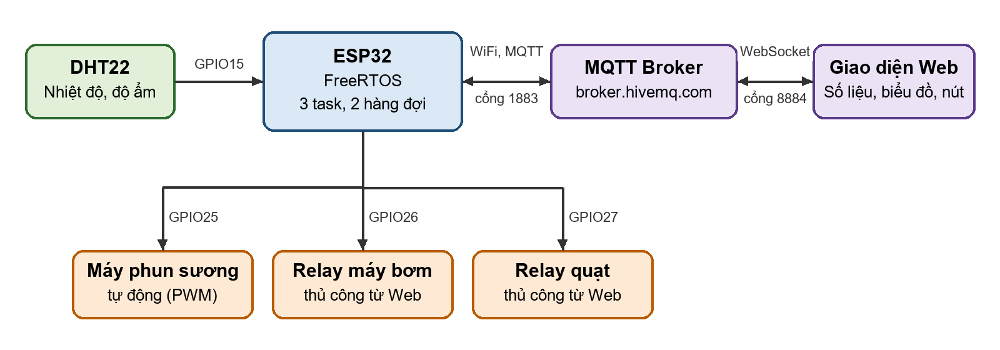

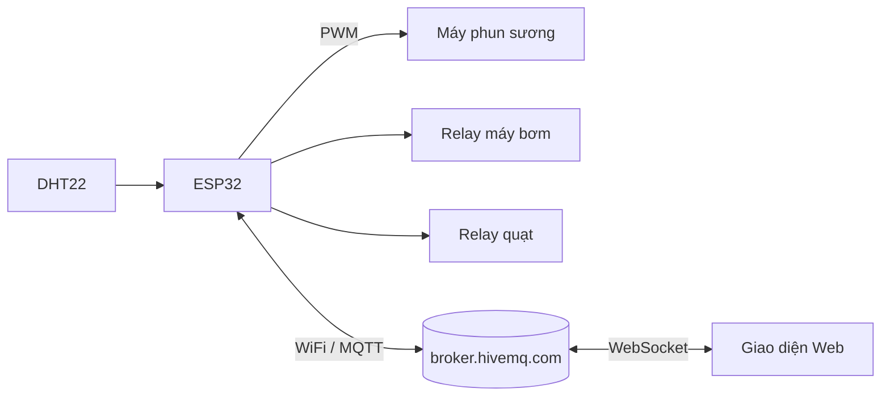

### 3.2. Sơ đồ mạch trên Wokwi

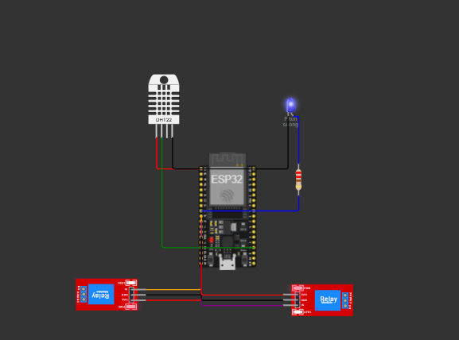

**Bảng kết nối chân:**

| Thiết bị | Chân thiết bị | Chân ESP32 | Ghi chú |
|---|---|---|---|
| DHT22 | VCC | 3V3 | Nguồn |
| DHT22 | SDA | GPIO15 | Dữ liệu |
| DHT22 | GND | GND | |
| Máy phun sương (LED xanh + R 220Ω) | A (qua điện trở) | GPIO25 | Điều khiển PWM, độ sáng thể hiện công suất |
| Máy phun sương | C | GND | |
| Relay 1, máy bơm | IN / VCC / GND | GPIO26 / 5V / GND | Điều khiển thủ công từ Web |
| Relay 2, quạt | IN / VCC / GND | GPIO27 / 5V / GND | Điều khiển thủ công từ Web |

Thư viện sử dụng ([libraries.txt](firmware/libraries.txt)):

| Thư viện | Công dụng |
|---|---|
| WiFi.h (có sẵn) | Kết nối WiFi |
| PubSubClient | Kết nối MQTT, publish và subscribe |
| ArduinoJson | Đóng gói và đọc dữ liệu dạng JSON |
| DHT sensor library for ESPx | Đọc cảm biến DHT22 |

### 3.3. Triển khai FreeRTOS trên ESP32

**Bảng dữ liệu các task:**

| Task | Core | Ưu tiên | Stack (byte) | Chu kỳ | Nhiệm vụ |
|---|---|---|---|---|---|
| Task truyền data (`TaskTruyenData`) | 0 | 1 | 8192 | Liên tục | Kết nối WiFi, MQTT. Lấy dữ liệu từ `dataQueue` gửi lên broker. Nhận lệnh điều khiển bơm, quạt. |
| Task đọc data (`TaskDocData`) | 1 | 2 | 4096 | 2 giây | Đọc DHT22, in Serial, gửi dữ liệu vào `dataQueue`, gửi độ ẩm vào `alertQueue` khi dưới 40%. |
| Task cảnh báo (`TaskCanhBao`) | 1 | 3 | 4096 | Theo sự kiện | Nhận độ ẩm từ `alertQueue`, điều khiển máy phun sương theo thuật toán. |

**Bảng hàng đợi:**

| Hàng đợi | Kích thước | Kiểu phần tử | Gửi | Nhận | Lý do chọn |
|---|---|---|---|---|---|
| `dataQueue` | 10 | `SensorData_t` (nhiệt độ, độ ẩm) | Task đọc data | Task truyền data | Giữ được 10 lần đo (20 giây) khi mất mạng, có mạng lại thì gửi bù |
| `alertQueue` | 1 | `float` (độ ẩm) | Task đọc data (`xQueueOverwrite`) | Task cảnh báo | Luôn giữ giá trị mới nhất, không dồn giá trị cũ khi máy đang phun |

**Kiến trúc RTOS và luồng dữ liệu giữa các task:**

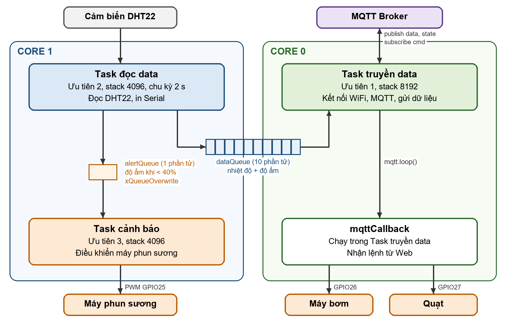

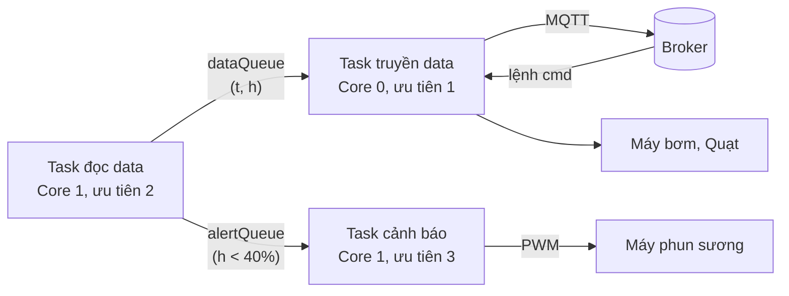

**Thuật toán máy phun sương:**

Cây cà phê và hồ tiêu cần độ ẩm ổn định từ 40% đến 60%. Khi độ ẩm dưới 40%, máy phun sương bật theo mức:

| Độ ẩm | Công suất | Duty PWM (8 bit) | Thời gian bật |
|---|---|---|---|
| Từ 40% trở lên | Tắt | 0 | |
| 35% đến dưới 40% | 25% | 63 | 10 giây |
| 30% đến dưới 35% | 50% | 127 | 20 giây |
| Dưới 30% | 100% | 255 | 30 giây |

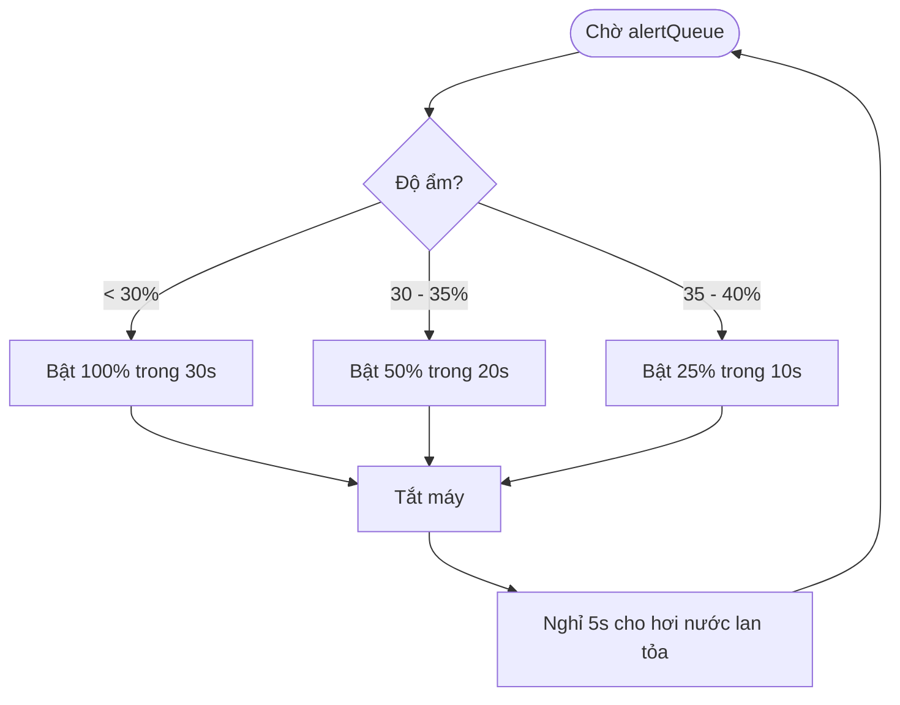

Giải pháp phù hợp thực tế đã áp dụng:
1. Máy phun sương điều khiển bằng **PWM**, nên chỉnh được công suất thay vì chỉ bật hoặc tắt.
2. Sau mỗi lần phun, máy **nghỉ 5 giây** cho hơi nước lan ra rồi mới đo lại, tránh phun liên tục gây đọng nước.
3. `alertQueue` chỉ chứa 1 phần tử và được ghi đè, nên sau khi phun xong hệ thống xét theo độ ẩm **mới nhất**.
4. Khi độ ẩm trên 60%, Serial in cảnh báo và web gợi ý bật quạt thông gió.

### 3.4. Giao thức MQTT

Broker: `broker.hivemq.com`. ESP32 dùng cổng 1883 (TCP), Web dùng cổng 8884 (WebSocket bảo mật).

| Topic | Chiều | Nội dung ví dụ |
|---|---|---|
| `vuoncafe/nanh/data` | ESP32 → Web | `{"temperature":28.5,"humidity":45}` |
| `vuoncafe/nanh/state` | ESP32 → Web | `{"pump":true,"fan":false,"mist":25}` (retained) |
| `vuoncafe/nanh/cmd` | Web → ESP32 | `{"device":"pump","state":1}` |

### 3.5. Giao diện Web

File [web/index.html](web/index.html) dùng thư viện **mqtt.js** để kết nối broker và **Chart.js** để vẽ biểu đồ. Giao diện gồm:

| Thành phần | Thẻ HTML | Chức năng |
|---|---|---|
| Nhiệt độ dạng số | `<div class="temp-value">` | Hiển thị nhiệt độ mới nhất |
| Độ ẩm dạng số | `<div class="humi-value">` | Hiển thị độ ẩm và nhận xét theo ngưỡng 40% đến 60% |
| Biểu đồ nhiệt độ | `<canvas id="tempChart">` | Cập nhật theo thời gian thực, giữ 20 điểm gần nhất |
| Biểu đồ độ ẩm | `<canvas id="humiChart">` | Cập nhật theo thời gian thực, giữ 20 điểm gần nhất |
| Nút Máy bơm | `<button id="pumpBtn">` | Bật tắt máy bơm (manual), màu xanh khi đang bật |
| Nút Quạt | `<button id="fanBtn">` | Bật tắt quạt (manual), màu xanh khi đang bật |
| Máy phun sương | `<div class="mist-value">` | Hiển thị công suất máy phun sương tự động |

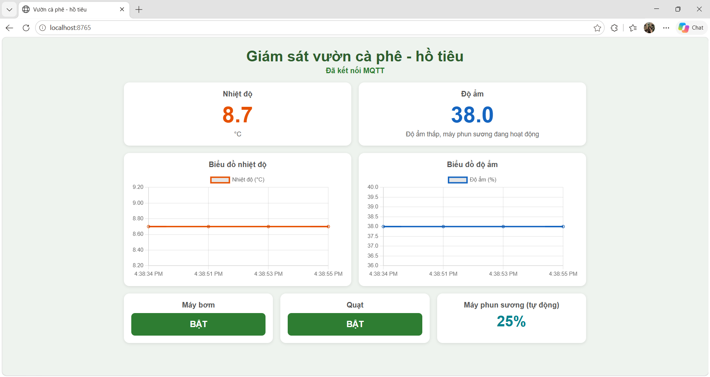

---

## 4. Code và giải thích

Code đầy đủ: [firmware/sketch.ino](firmware/sketch.ino).

### 4.1. Khởi tạo hàng đợi và task

```cpp
dataQueue  = xQueueCreate(10, sizeof(SensorData_t));
alertQueue = xQueueCreate(1, sizeof(float));

xTaskCreatePinnedToCore(TaskTruyenData, "TruyenData", 8192, NULL, 1, NULL, 0);
xTaskCreatePinnedToCore(TaskDocData,    "DocData",    4096, NULL, 2, NULL, 1);
xTaskCreatePinnedToCore(TaskCanhBao,    "CanhBao",    4096, NULL, 3, NULL, 1);
```

`xTaskCreatePinnedToCore` tạo task và gắn cố định vào một core. Tham số cuối là số core: Task truyền data chạy Core 0 (cùng core với WiFi của ESP32), hai task còn lại chạy Core 1. Trong `loop()` gọi `vTaskDelete(NULL)` vì mọi công việc đã giao cho các task.

### 4.2. Tạo kết nối WiFi và MQTT (Task truyền data, Core 0)

```cpp
WiFi.begin(WIFI_SSID, WIFI_PASS, 6);
while (WiFi.status() != WL_CONNECTED) {
  vTaskDelay(pdMS_TO_TICKS(500));
}
mqtt.setServer(MQTT_HOST, MQTT_PORT);
mqtt.setCallback(mqttCallback);
```

Task kết nối WiFi trước, chờ bằng `vTaskDelay` nên không chặn các task khác. Kết nối xong thì cấu hình broker và hàm `mqttCallback` để nhận lệnh. Trong vòng lặp, nếu mất WiFi thì gọi `WiFi.reconnect()`, nếu mất MQTT thì `reconnectMQTT()` kết nối lại và subscribe topic `cmd`.

### 4.3. Cập nhật dữ liệu

**Task đọc data (Core 1)** đọc cảm biến mỗi 2 giây và đưa vào hai hàng đợi:

```cpp
TempAndHumidity th = dht.getTempAndHumidity();
Serial.printf("[DHT22] Nhiet do: %.1f C | Do am: %.1f %%\n", ...);
xQueueSend(dataQueue, &data, 0);                    // dữ liệu đầy đủ
if (data.humidity < 40) {
  xQueueOverwrite(alertQueue, &data.humidity);      // dữ liệu cảnh báo
}
```

**Task truyền data (Core 0)** lấy dữ liệu từ `dataQueue`, đóng gói JSON và gửi lên broker:

```cpp
if (xQueueReceive(dataQueue, &data, pdMS_TO_TICKS(100)) == pdTRUE) {
  JsonDocument doc;
  doc["temperature"] = data.temperature;
  doc["humidity"]    = data.humidity;
  serializeJson(doc, buf);
  mqtt.publish(TOPIC_DATA, buf);
}
```

**Web** nhận dữ liệu, cập nhật thẻ số và thêm điểm vào biểu đồ:

```js
client.on("message", (topic, message) => {
  const data = JSON.parse(message.toString());
  if (topic === TOPIC_DATA) {
    document.getElementById("temp").textContent = data.temperature.toFixed(1);
    document.getElementById("humi").textContent = data.humidity.toFixed(1);
    addPoint(tempChart, data.temperature);
    addPoint(humiChart, data.humidity);
  }
});
```

### 4.4. Điều khiển

**Điều khiển tự động máy phun sương (Task cảnh báo, Core 1):**

```cpp
xQueueReceive(alertQueue, &humidity, portMAX_DELAY);   // ngủ chờ cảnh báo
if (humidity < 30)      { power = 100; timeSec = 30; }
else if (humidity < 35) { power = 50;  timeSec = 20; }
else if (humidity < 40) { power = 25;  timeSec = 10; }
setMist(power);                                        // ledcWrite PWM
vTaskDelay(pdMS_TO_TICKS(timeSec * 1000));
setMist(0);
```

Task chờ `alertQueue` với `portMAX_DELAY` nên không tốn CPU khi độ ẩm bình thường. Task này có ưu tiên cao nhất (3) để phản ứng ngay khi có cảnh báo.

**Điều khiển thủ công máy bơm và quạt từ Web:**

Khi bấm nút, Web gửi lệnh lên topic `cmd`:

```js
function toggle(device) {
  const newState = state[device] ? 0 : 1;
  client.publish(TOPIC_CMD, JSON.stringify({ device: device, state: newState }));
}
```

ESP32 nhận lệnh trong `mqttCallback`, bật tắt relay rồi gửi trạng thái mới lên topic `state`. Web nhận `state` mới đổi màu nút, nhờ đó nút trên Web luôn đúng với trạng thái thật của thiết bị.

```cpp
if (strcmp(device, "pump") == 0) {
  pumpState = state;
  digitalWrite(PUMP_PIN, pumpState);
}
stateChanged = true;   // Task truyền data sẽ publish trạng thái mới
```

---

## 5. Kết quả

### 5.1. Mô phỏng trên Wokwi và Serial Monitor

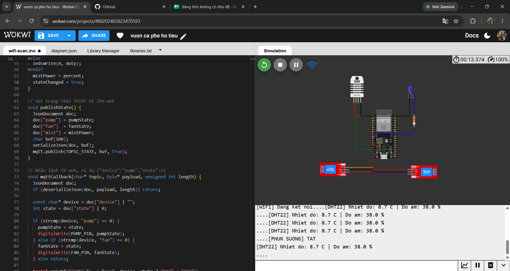

Serial hiển thị nhiệt độ, độ ẩm mỗi 2 giây và dòng gửi MQTT. Khi WiFi chưa kết nối, Task đọc data và Task cảnh báo vẫn chạy bình thường, chứng tỏ các task hoạt động song song độc lập.

### 5.2. Máy phun sương theo 3 mức độ ẩm

| Độ ẩm 39% (25%, 10s) | Độ ẩm 32% (50%, 20s) | Độ ẩm 17% (100%, 30s) |
|---|---|---|
| (xem báo cáo Word) | 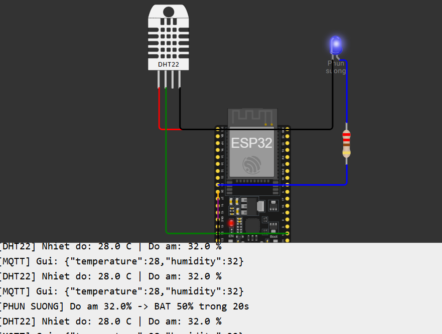 | 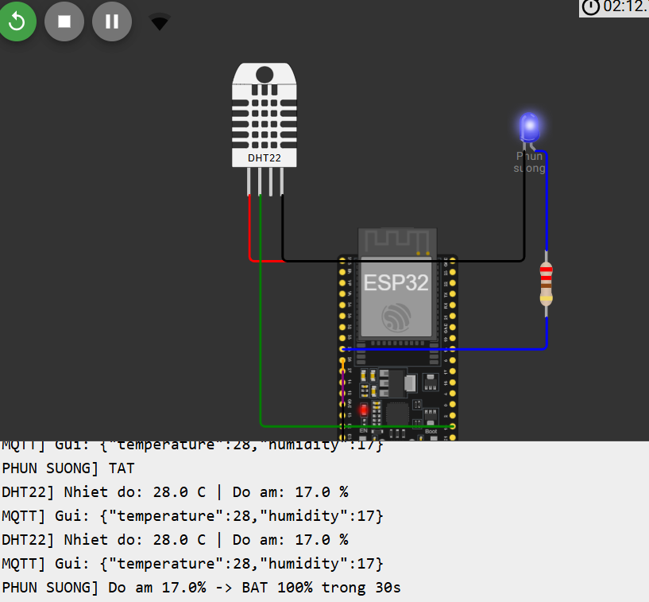 |

### 5.3. Giao diện Web và điều khiển


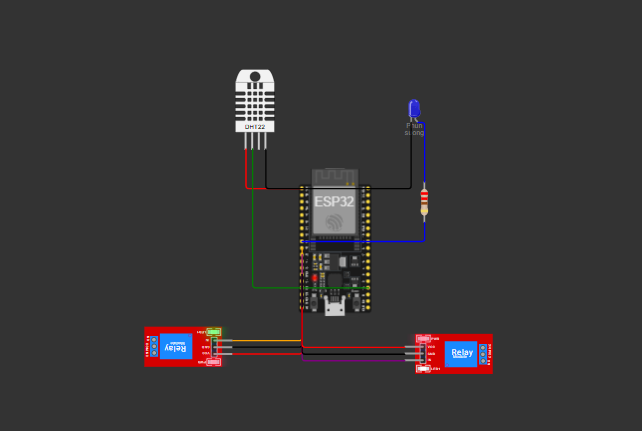

### 5.4. Bảng kiểm tra

| Nội dung kiểm tra | Kết quả |
|---|---|
| Đọc DHT22 và hiển thị Serial mỗi 2 giây | Đạt |
| Kết nối WiFi, MQTT và gửi dữ liệu lên broker | Đạt |
| Web hiển thị nhiệt độ, độ ẩm dạng số | Đạt |
| Biểu đồ cập nhật theo thời gian thực | Đạt |
| Nút Máy bơm, Quạt điều khiển được relay trên Wokwi | Đạt |
| Phun sương 25% trong 10s khi độ ẩm 35% đến 40% | Đạt |
| Phun sương 50% trong 20s khi độ ẩm 30% đến 35% | Đạt |
| Phun sương 100% trong 30s khi độ ẩm dưới 30% | Đạt |

---

## 6. Kết luận

Hệ thống đã đáp ứng đầy đủ yêu cầu của đề:
1. ESP32 đọc DHT22, hiển thị qua Serial và gửi lên MQTT Broker qua WiFi.
2. FreeRTOS chia hệ thống thành 3 task trên 2 core, giao tiếp qua 2 hàng đợi `dataQueue` và `alertQueue`.
3. Máy phun sương tự động giữ độ ẩm vườn cà phê, hồ tiêu ở mức từ 40% trở lên theo 3 mức công suất.
4. Web hiển thị dữ liệu dạng số, biểu đồ thời gian thực và điều khiển máy bơm, quạt.

**Hướng phát triển:** thêm cảm biến độ ẩm đất để điều khiển máy bơm tự động, dùng Mutex bảo vệ Serial khi nhiều task cùng in, lưu dữ liệu vào cơ sở dữ liệu để xem lịch sử, làm ứng dụng điện thoại.

---

## 7. Hướng dẫn chạy

1. Mở project Wokwi ở link phía trên, bấm ▶ để chạy mô phỏng.
2. Mở file `web/index.html` bằng trình duyệt (Chrome, Edge).
3. Trên Wokwi, bấm vào DHT22 để chỉnh nhiệt độ, độ ẩm và quan sát kết quả trên Serial, LED phun sương và Web.

## 8. Tài liệu tham khảo

1. FreeRTOS Documentation: https://www.freertos.org/Documentation
2. ESP-IDF FreeRTOS (SMP): https://docs.espressif.com/projects/esp-idf/en/latest/esp32/api-reference/system/freertos.html
3. Wokwi Docs: https://docs.wokwi.com
4. PubSubClient: https://pubsubclient.knolleary.net
5. MQTT.js: https://github.com/mqttjs/MQTT.js
6. Chart.js: https://www.chartjs.org
